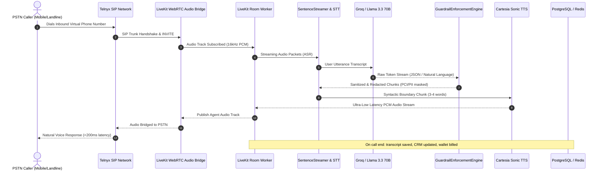

# Voice Force Technical Architecture & Systems Engineering Manual

This document provides a comprehensive technical overview of **Voice Force**, its monorepo packages, WebRTC audio bridge, database schema, and the 6 core algorithmic engines powering sub-200ms autonomous telephony.

---

## 1. System Topology & Request Lifecycle

Voice Force separates audio streaming, business logic, telephony signaling, and frontend views into dedicated decoupled tiers:

---

## 2. Monorepo Package Breakdown

Voice Force is structured as a **Turborepo** workspace with strict boundary isolation:

| Package | Path | Responsibility |
| :--- | :--- | :--- |
| **`@workspace/voiceforce-frontend`** | `apps/voiceforce-frontend` | Next.js 15 App Router web application providing 17 dashboards: Agent Studio, Number Marketplace, Call Logs, Real-Time Audio Monitor, Campaign Manager, and Billing Portal. |
| **`@workspace/voiceforce-backend`** | `apps/voiceforce-backend` | Express 4.19 server handling REST endpoints, Telnyx SIP webhook ingestion, room token issuance, and background worker orchestration. |
| **`@workspace/voiceforce`** | `packages/domains/voiceforce` | Pure TypeScript algorithmic domain containing all 6 mathematical engines, speech chunking, and tool definitions. Independent of web frameworks. |
| **`@workspace/wallet`** | `packages/domains/wallet` | Financial accounting domain: calculates per-second call rates, manages prepaid ledger balances, and triggers automated top-up thresholds. |
| **`@workspace/db-voiceforce`** | `packages/db-voiceforce` | Multi-tenant PostgreSQL database layer containing Prisma client, schema definitions, and migration scripts. |
| **`@workspace/backend-infra`** | `packages/backend-infra` | Shared security middleware: Helmet configuration, CORS policies, rate limiting, and response compression. |
| **`@workspace/identity-sdk`** | `packages/identity-sdk` | JWT verification and single sign-on (SSO) adapter. |
| **`@workspace/ui`** | `packages/ui` | Atomic design UI component library (buttons, inputs, cards, dialogs, badges). |

---

## 3. The 6 Core Algorithmic Engines

All 6 engines are located in `packages/domains/voiceforce/src/` and verified with automated test suites:

### 3.1 Sentence Streamer (`SentenceStreamer`)
* **Problem**: Traditional LLMs generate entire paragraphs before speech synthesis starts, creating an awkward 2-4 second latency.
* **Solution**: The `SentenceStreamer` parses streaming token deltas in real-time, detecting natural acoustic and syntactic boundaries (`.`, `?`, `!`, `,`, `;`, `:`).
* **Time-to-First-Audio (TTFA)**: Emits the first audio chunk after just **3-4 words**, achieving true sub-200ms conversational interruption response.
* **Lexical Protection**: Prevents premature splitting on currency numbers (`$149.99`), abbreviations (`Dr.`, `e.g.`, `Inc.`), and decimal values.

### 3.2 Guardrail Enforcement Engine (`GuardrailEnforcementEngine`)
* **PCI-DSS & PII Masking**: Automatically detects and redacts 13-19 digit credit card numbers and Social Security Numbers before transcripts are written to persistent storage.
* **Financial Protection**: Caps user-requested discounts at `maxDiscountPercent` (default 10-15%) and flags high-value transactions exceeding `maxOrderValue` for manager approval.
* **Lead-Time Buffer**: Blocks scheduling calendar appointments within 2 hours of current time to prevent rep scheduling conflicts.
* **Prompt Compiler**: Dynamically compiles strict operational Do's and Don'ts into the agent's system prompt.

### 3.3 Dynamic Telecom Rates & Profit Multiplier Engine (`DynamicRateService`)
* **Cost Equation**:
  $$\text{RealCost}_{\text{USD}} = \text{CarrierCost}_{\text{USD}} + \text{CartesiaVoiceCost}_{\text{USD}} \quad (\text{Cartesia} = \$0.0205/\text{min})$$
  $$\text{CustomerRate}_{\text{USD}} = \text{RealCost}_{\text{USD}} \times \text{Multiplier} \quad (\text{Default} = 1.8\times)$$
  $$\text{CustomerRate}_{\text{Local}} = \text{CustomerRate}_{\text{USD}} \times \text{FXRate}_{\text{Currency}}$$
* **Per-Second Billing**: Billed per-second without rounding up to arbitrary 60-second boundaries.
* **Number Lifecycle**: Enforces an automated 5-day grace period for unpaid numbers before relinquishing Telnyx carrier DIDs.

### 3.4 Telephony Forwarding Router (`ForwardingRouterService`)
* **Waterfall Cascade Routing**: Evaluates hops sequentially by priority (`priority: 1, 2, 3...`). Upon timeout or busy signal, automatically cascades to the next human rep or fallback AI agent.
* **Simultaneous Fan-Out Blast**: Rings all configured endpoints concurrently, bridging the first leg that answers and canceling remaining calls.
* **Round-Robin Fair-Share**: Balances inbound leads equally across team members with persisted state in Redis and in-memory fallback.
* **Timezone-Aware Schedules**: Evaluates 7-day schedule blocks against local IANA timezones (e.g., `Asia/Kolkata`, `America/New_York`) to divert after-hours calls to AI Voice Employees or Voicemail.

### 3.5 Call Queue Engine & In-Memory Resiliency (`CallQueueService`)
* **Dual-Layer Resilience**: Redis FIFO queue as primary store; automatically falls back to in-memory queues with zero downtime during network partitions or Redis maintenance.
* **Estimated Wait Time (EWT)**:
  $$\text{EWT} = \text{QueuePosition} \times \text{AverageWaitSeconds} \quad (\text{Default} = 45\text{s})$$
* **Queue Audio Loops**: Emits caller queue position updates and wait-music loops.

### 3.6 Enterprise Voice Intelligence Tool Suite
All 9 tools are fully registered in `voiceforceTools` with schema validation and execution handlers:
1. `bookAppointmentTool`: Calendar slot reservations and meeting scheduling.
2. `requestOrbitMeetingBookingTool`: Inter-agent delegation to central executive copilot.
3. `createSalesOrderTool`: Generates commercial invoices and sales drafts.
4. `sendSmsConfirmationTool`: Dispatches instant SMS and payment links to callers.
5. `searchBusinessKnowledgeTool`: Deep 50MB RAG knowledge vault search across company PDFs.
6. `searchKnowledgeBaseTool`: Universal knowledge base lookup alias.
7. `createTaskTool`: Follow-up task creation on company task boards.
8. `applyDiscountTool`: Guardrail-compliant retention discount application.
9. `transferToHumanTool`: Live SIP warm transfer and escalation handoff to human agents.

---

## 4. Multi-Tenant Database Schema

The database schema (`packages/db-voiceforce/prisma/schema.prisma`) is organized around the `Company` multi-tenant anchor:

- **`Company`**: Workspace entity owning users, agents, numbers, and balance.
- **`VoiceAgent`**: Defines voice persona, system prompt, temperature, provider (`cartesia` | `elevenlabs` | `openai`), and engine type (`cascaded` | `openai_realtime`).
- **`PhoneNumber`**: Provisions virtual numbers, carrier IDs, and forwarding targets.
- **`CallSession`**: Master call record containing duration, recording URLs, sentiment, caller ID, and transcript segments.
- **`VoiceWalletTransaction`**: Financial audit ledger for top-ups, usage deductions, and refunds.
- **`RagMemoryVault` & `Document`**: Vector and chunk storage for agent RAG retrieval.
- **`ForwardingRule` & `CallQueue`**: Routing cascade definitions and live waiting queues.
