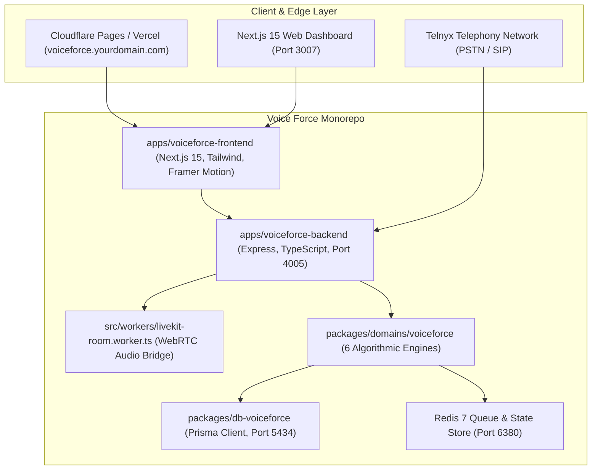

<div align="center">

# 🎙️ Voice Force
### Autonomous AI Voice Calling, Telephony Studio & Contact Operations Platform
**Sub-200ms Voice Synthesis • Real-Time WebRTC Audio • Inbound & Outbound Telephony • BYOK LLMs • Multi-Tenant Architecture**

[](./LICENSE)
[](https://nextjs.org/)
[](https://www.typescriptlang.org/)
[](https://turbo.build/)
[](https://livekit.io/)
[](https://telnyx.com/)
[](https://cartesia.ai/)
[](https://www.postgresql.org/)
[](https://redis.io/)

[Live Platform](https://voiceforce.vanityworkspace.com) • [Documentation](./docs/voiceforce-ai-telephony.md) • [Architecture Guide](./ARCHITECTURE.md) • [Commercial Terms](./COMMERCIAL_TERMS.md) • [Contributing](./CONTRIBUTING.md)

</div>

---

## ⚡ What is Voice Force?

**Voice Force** (developed within the 180 Workspace ecosystem) is a production-grade, enterprise-scale **Autonomous AI Telephony and Contact Operations Platform**. It enables developers, agencies, and enterprises to deploy human-like conversational voice agents capable of conducting **inbound customer support** and **high-scale outbound calling campaigns** with **sub-200ms latency**.

Unlike basic API wrappers or hobbyist speech bots, Voice Force includes a complete telecommunications stack: real-time streaming acoustic chunking, carrier-grade SIP trunking, multi-hop waterfall forwarding, PCI-DSS/PII redaction guardrails, automated prepaid telephony wallets, and deep tool calling for CRM synchronization, calendar booking, and payment processing.

### 🌟 Turn This into Your Own Business
> **Voice Force is 100% open and source-available!** You can take this entire codebase, rebrand it, deploy it to your own cloud, and launch a full-fledged **Voice AI Agency** or **Vertical Telephony SaaS** (for dental clinics, car dealerships, real estate firms, legal intake, or home services).  
> **Commercial terms are simple and founder-friendly**: You keep **90%** of your gross revenues, and share **10%** with Voice Force. See [COMMERCIAL_TERMS.md](./COMMERCIAL_TERMS.md) for complete details.

---

## 🚀 Key Features

| Capability | Description |
| :--- | :--- |
| **⚡ Sub-200ms Voice Synthesis** | Powered by Cartesia Sonic streaming TTS & acoustic token boundary detection. Eliminates awkward bot pauses so conversations feel 100% natural. |
| **📞 Inbound & Outbound Calling** | Instant SIP provisioning of virtual phone numbers (local, toll-free, national) across 60+ countries via Telnyx. |
| **🧠 Bring Your Own Key (BYOK)** | Switch seamlessly between **Groq (Llama 3.3 70B)** for sub-250ms time-to-first-token, **OpenAI (GPT-4o / Realtime)**, Claude 3.5, or Gemini. |
| **🛡️ Built-in Guardrail Engine** | Zero-tolerance PCI-DSS credit card masking, SSN scrubbing, discount caps, order escalation thresholds, and lead-time booking buffers. |
| **🔀 Smart Forwarding & Router** | Waterfall cascade routing, simultaneous fan-out ringing, round-robin lead distribution, and timezone-aware business hour schedules. |
| **⏳ Resilient Call Queuing** | Dual-layer FIFO queue architecture (Redis primary with seamless in-memory fallback during network splits) with Estimated Wait Time (EWT) calculations. |
| **🛠️ 9 Enterprise Tool Actions** | Voice agents can natively book appointments, query 50MB RAG knowledge vaults, create invoices, send SMS payment links, and execute warm SIP transfers to live human reps. |
| **💳 Prepaid Billing & Wallet** | Complete prepaid telecom wallet supporting real-time per-second billing, automated low-balance threshold top-ups, and currency conversion. |
| **📊 Real-Time Analytics & CRM** | Automatic call recording storage in Cloudflare R2, word-level audio transcript synchronization, caller sentiment scoring, and objection tagging. |

---

## 🏗️ Architecture & Monorepo Topology

Voice Force is structured as a high-performance **Turborepo** monorepo with complete decoupling between frontend, backend microservices, database schemas, and mathematical domain engines:



### Monorepo Packages:
* **`apps/voiceforce-frontend`**: Next.js 15 App Router dashboard with 17 production views (Agent Builder, Call Logs, Campaign Studio, Phone Number Marketplace, Wallet).
* **`apps/voiceforce-backend`**: High-throughput Express REST API, WebRTC room manager, and Telnyx webhook ingestion service.
* **`packages/domains/voiceforce`**: Core algorithmic domain containing all 6 mathematical engines (Dynamic Rates, Forwarding Router, Call Queue, Sentence Streamer, Guardrails, Tool Suite).
* **`packages/domains/wallet`**: Financial ledger, per-second rate calculator, and recharge pipeline.
* **`packages/db-voiceforce`**: Isolated PostgreSQL schema managed by Prisma ORM.
* **`packages/backend-infra`**: Shared enterprise middleware (Helmet, CORS, rate-limiters, compression).
* **`packages/identity-sdk`**: Authentication and single-sign-on (SSO) client adapter.
* **`packages/ui`**: Shared atomic UI component library.

---

## 💻 Tech Stack Breakdown

Voice Force is built with modern, battle-tested technologies designed for low latency and infinite horizontal scaling:

| Layer | Technologies |
| :--- | :--- |
| **Frontend Dashboard** | Next.js 15.5, React 19, Tailwind CSS 3.4, Framer Motion 12, Lucide Icons, React Hot Toast |
| **Backend API** | Node.js 20+, Express 4.19, TypeScript 5.7, LiveKit Server SDK, BullMQ, ioredis |
| **WebRTC & Audio Bridge** | LiveKit Cloud / LiveKit Server, SIP Trunking Dispatcher, PCM 16kHz audio streaming |
| **Telecommunications** | Telnyx Voice API, SIP Trunking, Global DID Provisioning, Inbound Call Webhooks |
| **Voice Synthesis (TTS)** | Cartesia Sonic API (ultra-low latency sub-200ms streaming audio generation) |
| **Reasoning Brain (LLM)** | Groq (Llama 3.3 70B Versatile for 250ms TTFT), OpenAI (GPT-4o, Realtime API) |
| **Database & Caching** | PostgreSQL 16 (Relational multi-tenant schema), Redis 7 (FIFO queues, session locks) |
| **Object Storage** | Cloudflare R2 / AWS S3 (Encrypted call recordings and business PDF knowledge vaults) |
| **Payments & Wallets** | Razorpay / Stripe (Automated credit card and UPI wallet recharges) |
| **DevOps & Monorepo** | Turborepo, pnpm 9 workspaces, Docker & Docker Compose |

---

## 🔑 Environment Variables (`.env`)

Create a `.env` file in the root directory by copying `.env.example`:
```bash
cp .env.example .env
```

Here is the complete reference of all required and optional environment variables:

| Variable | Required | Default | Description & API Provider |
| :--- | :---: | :--- | :--- |
| **`NODE_ENV`** | No | `development` | Runtime environment (`development` or `production`). |
| **`PORT`** | Yes | `4005` | Express backend listening port. |
| **`FRONTEND_PORT`** | Yes | `3007` | Next.js frontend dev server port. |
| **`CLIENT_URL`** | Yes | `http://localhost:3007` | Authorized frontend origin for CORS policies. |
| **`DATABASE_URL`** | Yes | `postgresql://...:5434/...` | PostgreSQL connection string with schema support. |
| **`REDIS_URL`** | Yes | `redis://localhost:6380` | Redis connection string for FIFO call queues and locks. |
| **`JWT_SECRET`** | Yes | *Required in Prod* | 32+ character cryptographic secret for session JWT tokens. |
| **`LIVEKIT_API_KEY`** | Yes | - | API Key from [LiveKit Cloud](https://livekit.io/) or self-hosted. |
| **`LIVEKIT_API_SECRET`** | Yes | - | API Secret from LiveKit Cloud. |
| **`LIVEKIT_WS_URL`** | Yes | `wss://...livekit.cloud` | LiveKit WebSocket endpoint URL. |
| **`LIVEKIT_SIP_TRUNK_ID`**| Yes | - | Inbound SIP Trunk ID configured in LiveKit to bridge Telnyx. |
| **`TELNYX_API_KEY`** | Yes | - | Secret API key from [Telnyx Portal](https://portal.telnyx.com/) for SIP and DIDs. |
| **`TELNYX_PUBLIC_KEY`** | No | - | Public key for verifying Telnyx webhook signatures. |
| **`CARTESIA_API_KEY`** | Yes | - | API Key from [Cartesia](https://cartesia.ai/) for sub-200ms voice generation. |
| **`GROQ_API_KEY`** | Yes | - | API Key from [Groq Console](https://console.groq.com/) for Llama 3.3 70B inference. |
| **`OPENAI_API_KEY`** | Optional | - | API Key from [OpenAI](https://platform.openai.com/) (if using GPT-4o or Realtime). |
| **`RAZORPAY_KEY_ID`** | Optional | - | Razorpay Key ID for processing wallet payments (or Stripe). |
| **`RAZORPAY_KEY_SECRET`**| Optional | - | Razorpay Secret Key for verifying payment signatures. |
| **`R2_ACCESS_KEY_ID`** | Optional | - | Cloudflare R2 / S3 access key for storing audio recordings. |
| **`R2_SECRET_ACCESS_KEY`**| Optional | - | Cloudflare R2 / S3 secret access key. |
| **`R2_BUCKET_NAME`** | Optional | `voiceforce-recordings`| Name of the R2 bucket for MP3/WAV call recordings. |
| **`R2_ENDPOINT`** | Optional | `https://...r2.cloudflarestorage.com` | S3-compatible R2 endpoint URL. |

---

## 💰 Monthly Operational Cost Breakdown

Running Voice Force is exceptionally cost-effective compared to closed-source SaaS competitors (like Bland AI or Vapi). Because Voice Force allows you to connect directly to infrastructure and AI providers at raw wholesale cost, your monthly overhead is minimal.

### 1. Fixed Baseline Infrastructure (Monthly)

| Service / Resource | Provider | Free / Starter Tier | Production Scale (1,000+ Calls/Day) |
| :--- | :--- | :---: | :---: |
| **Web Frontend** | Cloudflare Pages / Vercel | **$0.00** (Free) | $20.00 / mo |
| **Backend Compute** | Hetzner / Railway / Render / VPS | **$5.00 - $10.00** | $25.00 - $60.00 / mo |
| **PostgreSQL 16** | Neon / Supabase / Self-hosted Docker | **$0.00** (Free tier) | $15.00 - $35.00 / mo |
| **Redis 7** | Upstash / Self-hosted Docker | **$0.00** (Free tier) | $10.00 - $20.00 / mo |
| **Audio Recordings (R2)**| Cloudflare R2 | **$0.00** (10GB free) | $1.50 / 100GB / mo |
| **ESTIMATED FIXED BASELINE** | | **~$10 - $25 / month** | **~$70 - $135 / month** |

### 2. Variable Usage Rates (Pay-As-You-Go per Call Minute)

When a voice agent conducts a 1-minute conversation, the wholesale breakdown is:

| Component | Provider & Model | Wholesale Cost per Minute |
| :--- | :--- | :--- |
| **PSTN Telephony (Inbound)** | Telnyx Local Number | **$0.0050 / min** |
| **PSTN Telephony (Outbound)** | Telnyx US Outbound | **$0.0130 / min** |
| **WebRTC Audio Transport** | LiveKit Cloud | **$0.0040 / min** (Free for first 500 min/mo) |
| **Speech-to-Text (STT)** | Deepgram Nova-3 | **$0.0043 / min** |
| **LLM Reasoning Brain** | Groq (Llama 3.3 70B, ~300 tokens/min) | **$0.0015 / min** |
| **Voice Synthesis (TTS)** | Cartesia Sonic (Sub-200ms) | **$0.0205 / min** |
| **TOTAL WHOLESALE COST** | **All In (Inbound / Outbound)** | **~$0.035 - $0.045 / minute** |

### 3. Business Profitability Example

| Scenario | Wholesale Cost | Suggested Selling Price | Your Net Profit (After 10% RevShare) |
| :--- | :---: | :---: | :---: |
| **Inbound Dental Receptionist** (1,000 mins/mo) | ~$40 / mo | **$250 / mo** flat retainer | **$185.00 / mo profit** |
| **Outbound Real Estate Lead Qualifier** (5,000 mins/mo) | ~$225 / mo | **$0.20 / min** ($1,000 / mo) | **$675.00 / mo profit** |
| **Multi-Location Auto Dealership** (20,000 mins/mo) | ~$900 / mo | **$0.18 / min** ($3,600 / mo) | **$2,340.00 / mo profit** |

---

## 💼 Commercial Licensing & 10% Revenue Share

Voice Force is distributed under the **Voice Force Community & Commercial Revenue-Share License**:

1. **Free for Non-Commercial & Open Source**:
   * Personal hobby projects, students, academic research, non-profits, and code contributions are **100% free forever** under standard MIT terms.
2. **Commercial Deployment / Agency / SaaS Transformation**:
   * Anyone is legally authorized to take Voice Force, rebrand it, sell subscriptions, charge clients for phone agents, and build a multi-million-dollar voice telecommunications company.
   * Commercial operators agree to share **10% of gross revenue** generated by their Voice Force deployment.
   * You keep **90%** of all customer subscription fees, setup fees, and usage markups.
   * Read the complete legal terms and reporting schedule in [COMMERCIAL_TERMS.md](./COMMERCIAL_TERMS.md).
   * Register your commercial project: `partners@vanityworkspace.com`.

---

## 🛠️ Step-by-Step Installation & Quickstart

### Prerequisites
* **Node.js**: `v20.0.0` or higher
* **Package Manager**: `pnpm` v9 (`npm install -g pnpm`)
* **Docker & Docker Compose**: Installed and running locally
* **API Accounts**:
  * [LiveKit Cloud](https://livekit.io/) (Free tier available)
  * [Telnyx](https://telnyx.com/) (For SIP trunk & virtual numbers)
  * [Cartesia](https://cartesia.ai/) (For ultra-low latency voice)
  * [Groq](https://console.groq.com/) (For fast LLM inference)

### Step 1: Clone the Repository
```bash
git clone https://github.com/your-username/voice-force.git
cd voice-force
```

### Step 2: Install Monorepo Dependencies
```bash
pnpm install
```

### Step 3: Launch Local PostgreSQL & Redis Containers
Voice Force includes a pre-configured `docker-compose.yml` that starts PostgreSQL on port `5434` and Redis on port `6380` (preventing conflicts with standard local instances):
```bash
docker-compose up -d
```
Verify the containers are healthy:
```bash
docker ps
```

### Step 4: Configure Environment Variables
```bash
cp .env.example .env
```
Open `.env` and fill in your database credentials and API keys (`CARTESIA_API_KEY`, `GROQ_API_KEY`, `LIVEKIT_API_KEY`, `TELNYX_API_KEY`).

### Step 5: Push Database Schema & Generate Prisma Client
```bash
pnpm db:push
pnpm db:generate
```

### Step 6: Start Concurrent Development Servers
Run the bundled concurrent development runner:
```bash
node scripts/dev-runner.js
```

This single command starts:
* **Voice Force Backend API**: `http://localhost:4005`
* **Voice Force Web Dashboard**: `http://localhost:3007`

Open your browser and navigate to `http://localhost:3007` to explore the Voice Force dashboard!

---

## 🧪 Testing & Algorithmic Verification

Voice Force includes a comprehensive test suite covering all 6 mathematical engines (PII/PCI redaction, discount guardrails, acoustic sentence streaming, rate multipliers, forwarding waterfall routing, and FIFO call queues):

```bash
# Run the complete test suite
node scratch/test-all-algorithms-real.js
```

**Test Audit Result:** `41 / 41 Tests Passed (100% Pass Rate, 0 Failures)`

---

## 🤝 How to Contribute

We welcome open-source contributions from developers worldwide! You can contribute in many ways:
* 🐛 **Report Bugs**: Open a detailed issue on GitHub with reproduction steps.
* 💡 **Feature Requests**: Suggest new voice models, telephony carrier adapters, or CRM integrations.
* 🔀 **Pull Requests**:
  1. Fork the repository.
  2. Create a feature branch (`git checkout -b feat/twilio-carrier-adapter`).
  3. Commit your changes using [Conventional Commits](https://www.conventionalcommits.org/) (`git commit -m "feat(carrier): add twilio SIP provider"`).
  4. Ensure all tests pass (`pnpm turbo run lint` & test scripts).
  5. Push to your branch and open a Pull Request.

Please read our [CONTRIBUTING.md](./CONTRIBUTING.md) and [CODE_OF_CONDUCT.md](./CODE_OF_CONDUCT.md) before submitting code.

---

## 🗺️ Roadmap & Upcoming Milestones

See the detailed [ROADMAP.md](./ROADMAP.md) for our upcoming releases:
- [x] **v1.0**: Sub-200ms Cartesia synthesis, Telnyx SIP bridge, 9 enterprise tools, guardrails engine.
- [ ] **v1.1**: Direct Twilio & Plivo carrier adapter modules.
- [ ] **v1.2**: Native WhatsApp & SMS post-call workflow automation.
- [ ] **v1.3**: Zero-code visual Drag-and-Drop Voice Flow Builder.
- [ ] **v1.4**: Multilingual auto-detection across 40+ spoken dialects.

---

## 🔒 Security & Vulnerability Reporting

Security and privacy are foundational to voice communications. If you discover a vulnerability or security bug, please review our [SECURITY.md](./SECURITY.md) and email `security@vanityworkspace.com` for responsible disclosure. Do **not** open public GitHub issues for security vulnerabilities.

---

## 📄 License & Commercial Rights

* **Community & Open-Source Use**: Free under the terms of the [LICENSE](./LICENSE).
* **Commercial SaaS & Agency Operations**: Permitted subject to the 10% Gross Revenue Share agreement. See [COMMERCIAL_TERMS.md](./COMMERCIAL_TERMS.md).

---

<div align="center">
  <sub>Built with ❤️ by the Voice Force / 180 Workspace Engineering Community</sub><br>
  <sub>For partnerships, enterprise white-label licensing, or questions, reach out to <b>partners@vanityworkspace.com</b></sub>
</div>
