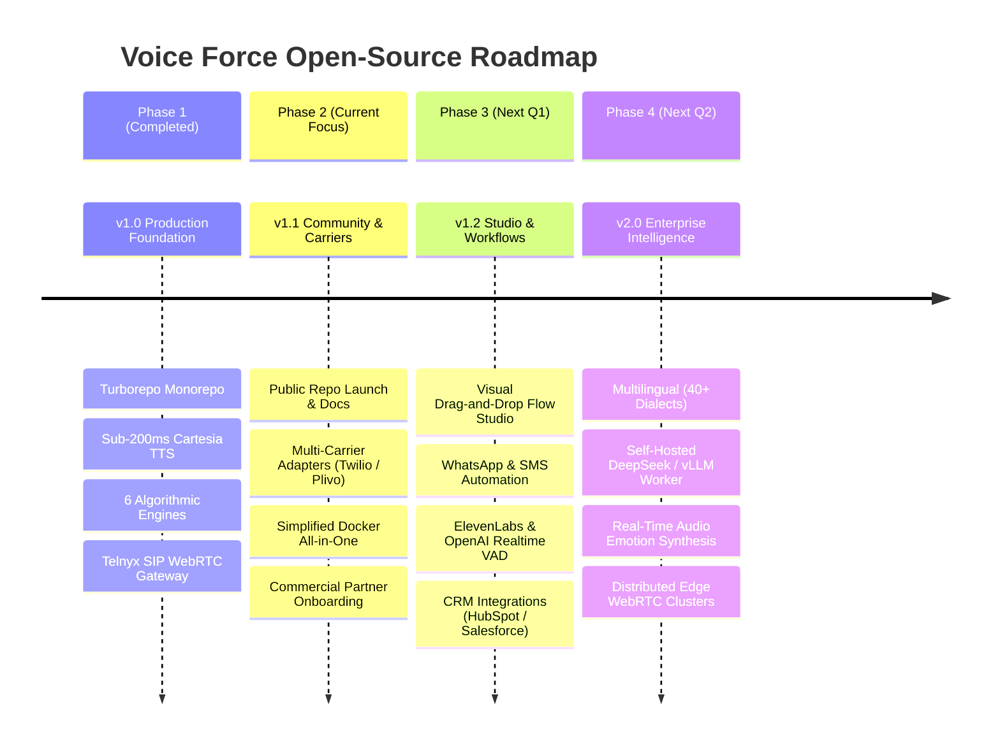

# Voice Force Open-Source Development Roadmap

This roadmap outlines the phase-by-phase development plan for Voice Force, guiding contributors, maintainers, and commercial partners through upcoming releases, architectural enhancements, and ecosystem expansions.

---

## 📅 Roadmap Overview

---

## 🚀 Phase 1: Production Core Architecture (Completed ✅)

- [x] **Monorepo Unification**: Turborepo setup with 9 isolated packages (`frontend`, `backend`, `domains`, `db`, `infra`).
- [x] **Sub-200ms Streaming Voice Pipeline**: `SentenceStreamer` token delta parser with acoustic punctuation boundary detection.
- [x] **Telnyx SIP & LiveKit Bridge**: WebRTC bidirectional audio streaming over PCM 16kHz.
- [x] **6 Algorithmic Domain Engines**:
  - `DynamicRateService`: Telecom rate multiplier and per-second billing.
  - `ForwardingRouterService`: Waterfall cascade, fan-out blast, and timezone-aware business hours.
  - `CallQueueService`: Resilient FIFO queue with Estimated Wait Time (EWT) calculations.
  - `GuardrailEnforcementEngine`: PCI-DSS card masking, SSN scrubbing, and financial discount caps.
  - `SentenceStreamer`: Lexical boundary protector and TTFA accelerator.
  - `voiceforceTools`: 9 registered enterprise tools (booking, orders, SMS, RAG search, warm transfer).
- [x] **Prepaid Wallet Ledger**: Automated recharge triggers and currency FX conversions.
- [x] **Verification Suite**: 41/41 passing automated tests with zero TypeScript errors.

---

## 📦 Phase 2: Community Launch & Multi-Carrier Expansion (Q4 2026 - Current)

- [x] **Open-Source Repository Documentation**:
  - Comprehensive `README.md` with SEO optimization for search engines.
  - Community & Commercial Revenue-Share `LICENSE` (10% commercial covenant).
  - `COMMERCIAL_TERMS.md` agency & SaaS blueprint.
  - `CONTRIBUTING.md`, `CODE_OF_CONDUCT.md`, and `SECURITY.md`.
  - Full system engineering manual in `ARCHITECTURE.md`.
- [ ] **Multi-Carrier Telephony Adapters**:
  - [ ] Twilio SIP Trunking & Inbound Webhooks adapter.
  - [ ] Plivo Voice API adapter.
  - [ ] Generic SIP / FreeSWITCH / Asterisk PBX connector.
- [ ] **One-Click Deployments**:
  - [ ] Railway template.
  - [ ] Render Blueprint (`render.yaml`).
  - [ ] Fly.io multi-region configuration (`fly.toml`).
  - [ ] DigitalOcean Marketplace 1-Click App.
- [ ] **Interactive Voice Sandbox**:
  - WebRTC browser-based microphone testing directly inside the frontend without requiring a PSTN phone call.

---

## 🎨 Phase 3: Visual Flow Builder & Omnichannel Post-Call Automation (Q1 2027)

- [ ] **Visual Node-Based Conversation Studio**:
  - Drag-and-drop React Flow canvas for designing multi-branch voice conversations.
  - Conditional branching based on caller intent, sentiment, or tool output.
  - Fallback loops and DTMF keypad input handlers.
- [ ] **Omnichannel Follow-Up Automation**:
  - Immediate post-call WhatsApp notification dispatch with call summary.
  - Dynamic SMS payment link generation with webhook payment receipt listener.
  - Automatic Google Calendar / Outlook Calendar event invitations sent to callers.
- [ ] **Advanced Voice Engines**:
  - [ ] ElevenLabs Conversational AI WebSockets adapter.
  - [ ] OpenAI Realtime API audio-to-audio native integration.
  - [ ] Local Whisper streaming STT fallback for air-gapped deployments.
- [ ] **Turnkey CRM Integrations**:
  - Native OAuth connectors for HubSpot, Salesforce, Zoho, and GoHighLevel.

---

## 🌐 Phase 4: Enterprise Scale & Edge Voice Intelligence (Q2 2027)

- [ ] **Global Multilingual Support**:
  - Automatic language switching during live calls across 40+ languages and regional accents.
  - Real-time language translation for multilingual call centers.
- [ ] **Self-Hosted LLM Telephony Worker**:
  - Optimization for running local quantized models (Llama 3.3 70B / DeepSeek V3) via vLLM on local GPUs (NVIDIA RTX 4090 / A100), reducing per-minute inference costs to zero.
- [ ] **Emotional Speech Modulation**:
  - Dynamic voice pitch and cadence modulation based on caller emotional state (e.g., calming cadence for frustrated callers, upbeat tone for sales prospects).
- [ ] **Geographic Edge Audio Clusters**:
  - Multi-region LiveKit WebRTC edge nodes in US-East, Europe-West, and Asia-South to reduce audio network latency to <30ms globally.

---

## 💡 How Features are Prioritized

Community feedback and commercial partner requirements drive our development priorities.
- To propose a new feature, open a GitHub Discussion or submit an issue with the `[RFC]` tag.
- Commercial partners participating in the 10% Revenue Share program receive priority architectural and feature voting rights.
