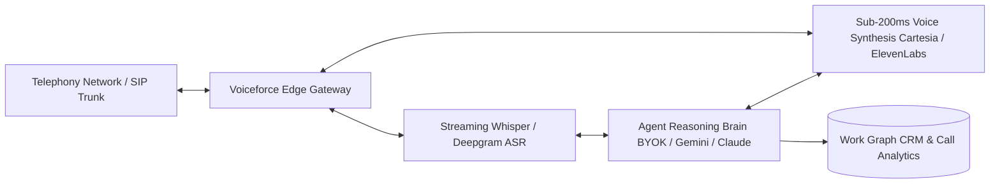

# Voiceforce AI Calling & Telephony Architecture

**Voiceforce** is the autonomous AI telephony and voice operations application within the 180 Workspace operating system. It deploys conversational voice agents capable of conducting inbound and outbound telephone calls with sub-200ms latency.



---

## 1. Key Capabilities

- **Sub-200ms Ultra-Low Latency Synthesis**: Conversational agents respond before human conversation awkwardness kicks in, utilizing streaming text-to-speech pipelines.
- **Dedicated Virtual Phone Numbers**: Instant provisioning of local, national, and toll-free virtual numbers across 60+ countries.
- **BYOK (Bring Your Own Keys)**: Connect your own API keys for Gemini 1.5, Claude 3.5, OpenAI GPT-4o, or self-hosted vLLM instances to minimize per-minute telephony overhead.
- **Autonomous Outbound Campaigns**: Dispatch automated call sequences to qualified CRM leads for appointment setting, payment reminders, or survey collection.

---

## 2. Work Graph Integration

When a call completes:
1. **Audio Recording & Transcript Vault**: Stored with encrypted tenant isolation in 180 Cloud Drive.
2. **Sentiment & Intent Extraction**: Extracts action items, objection tags, and buyer sentiment scores.
3. **Automatic CRM Lead Update**: Logs the call activity on the deal timeline, updates lead status, and alerts account managers on high-intent calls.
4. **Trigger Downstream Actions**: If the customer agrees to a purchase, Voiceforce automatically sends a **180 Pay** payment link via SMS or WhatsApp.

---

## 3. Telephony API Dispatch Example

```typescript
import { WorkspaceClient } from '@180workspace/sdk';

const client = new WorkspaceClient({
  apiKey: process.env.WORKSPACE_API_KEY,
});

// Programmatically dispatch an outbound agent call
const call = await client.voiceforce.dispatchCall({
  toNumber: '+14155552671',
  agentId: 'agnt_sales_qualification_v2',
  contextPrompt: 'Customer inquired about Momentum 180 Workspace plan. Qualify budget and schedule demo.',
  metadata: {
    dealId: 'deal_98721',
    assignedRep: 'usr_sarah',
  },
});

console.log('Call dispatched. Call ID:', call.id);
```
